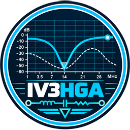
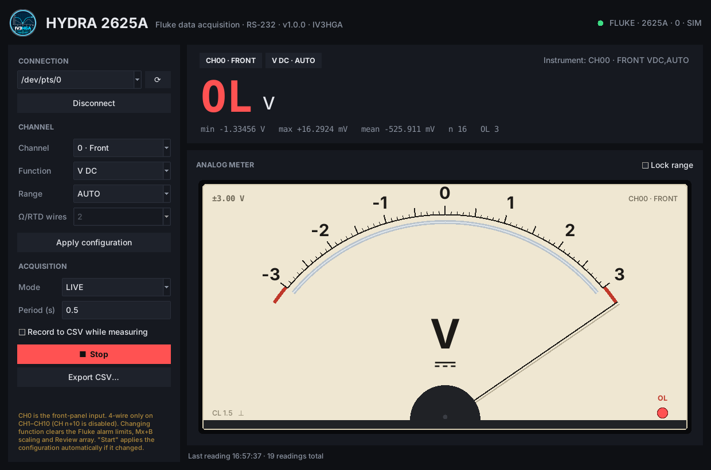

<p align="center">
  
</p>

<h1 align="center">Fluke Hydra Monitor</h1>

<p align="center">
  A modern Linux front-end for the <b>Fluke Hydra 2620A / 2625A</b> data acquisition unit over RS-232:<br>
  big digital readout, a damped <b>analog moving-coil meter</b>, a live <b>auto-scaling chart</b> and CSV logging.
</p>

<p align="center">
  
  
</p>

The original Fluke software is DOS/Windows-era and hard to run today. This is a single Python
script (Tkinter + matplotlib + pyserial) that talks to the instrument directly and needs nothing
else installed.

## Features

- **All Hydra functions**: V DC, V AC, Ω (2- and 4-wire), frequency, thermocouples (J K E T N R S B C), Pt100 RTD.
- **21 channels**, with **CH0 = front-panel input** clearly marked in the UI.
- **Three acquisition modes**
  - **LIVE**: digital readout + analog meter, using the Hydra's *Monitor* function.
  - **MONITOR (chart)**: digital readout + scrolling history chart.
  - **Trigger + LAST?**: explicit `*TRG` followed by `LAST? ch`, for scan-based setups.
- **Analog meter** drawn like a classic panel instrument: cream dial, anti-parallax mirror,
  2nd-order needle dynamics (slight overshoot), end-stop bounce, OL lamp.
  - Automatic **1-3-10-30 range switching** with hysteresis (up at once, down after 4 readings), or **Lock range**.
  - Switches to a **centre-zero** (±FS) scale automatically when a negative DC/temperature value appears.
- **Chart** with *smart* Y autoscale (expands immediately, shrinks only when the signal uses less
  than ~⅓ of the axis, so it does not jump around), SI-prefixed axis (mV, kΩ…), mean line,
  last-point marker, selectable time window (10 s … 1 h) and **manual limits** that accept SI suffixes (`300m`, `1.5k`).
- **Statistics**: min / max / mean / count, overload count.
- **Overload handling**: OL readings are shown in red, break the chart line and are excluded from statistics.
- **CSV**: continuous recording while measuring (flushed at every reading) and export of the whole session.
- **Robust serial handling**: a single worker thread owns the port, transient read errors are retried
  (3 attempts), fixed-step scheduling avoids period drift, `MON 0` is sent on stop and on exit.
- **Simulator** included, to try the GUI without an instrument.

## Requirements

- Linux (should also work on macOS/Windows; the simulator needs a POSIX pty)
- Python ≥ 3.8 with Tkinter
- `pyserial`, `matplotlib`

```bash
# Debian / Ubuntu
sudo apt install python3-tk python3-serial python3-matplotlib
# optional, nicer UI font
sudo apt install fonts-inter
```

or with pip:

```bash
pip install -r requirements.txt
```

## Quick start

```bash
git clone https://github.com/metallarox/fluke_hydra_monitor.git
cd fluke_hydra_monitor
python3 fluke_hydra_monitor.py
```

1. **Connection**: pick the serial port (⟳ refreshes the list) and press **Connect**. The header shows the `*IDN?` string and the status LED turns green.
2. **Channel**: choose channel, function, range and (for Ω/RTD) 2 or 4 wires. *Apply configuration* is optional, **Start** applies it automatically if it changed.
3. **Acquisition**: choose the mode and the period (0.5 … 3600 s), optionally tick *Record to CSV*, then **Start**. The same button becomes **Stop**.

### Serial port permissions

If the port cannot be opened, add your user to the `dialout` group and log in again:

```bash
sudo usermod -aG dialout $USER
```

### Instrument settings

Set the Hydra RS-232 interface to **9600 baud, 8 data bits, no parity, 1 stop bit**, no handshake.
Echo can be on or off: the command echo is stripped automatically. If the unit never answers,
check the cable wiring (straight vs null-modem) against the Hydra user manual.

## Try it without the instrument

```bash
python3 tools/hydra_simulator.py              # prints e.g. "listening on /dev/pts/5"
python3 fluke_hydra_monitor.py                # connect to /dev/pts/5
```

Simulator options: `--volts`, `--amplitude`, `--period`, `--overload-every N`.

## Screenshots

| | |
|---|---|
|  |  |
| Negative input: the meter switches to a ±3 V centre-zero scale | Overload: needle on the end stop, OL lamp, red readout |

## CSV format

```
timestamp,channel,function,value,unit
2026-10-26T16:53:08.412,0,V DC,0.0160495,V
```

Values are always in base units (V, Ω, Hz, °C/°F as set on the Hydra). Overload readings have an empty `value`.

## Documentation

- [docs/USER_GUIDE.md](docs/USER_GUIDE.md): full description of the interface and of every mode
- [docs/PROTOCOL.md](docs/PROTOCOL.md): the RS-232 commands used and how the software drives the instrument

## Known limitations / to verify

- The overrange value is assumed to be ≥ 9E+9 (constant `OVERLOAD`); check what your unit returns with an open Ω input.
- *Trigger + LAST?* does not enable scanning; depending on the Hydra trigger configuration a `SCAN 1` / `TRIGGER` setup may be needed.
- One channel at a time; multi-channel scanning is a natural next step.

---

<p align="center"><sub>73 de IV3HGA</sub></p>
