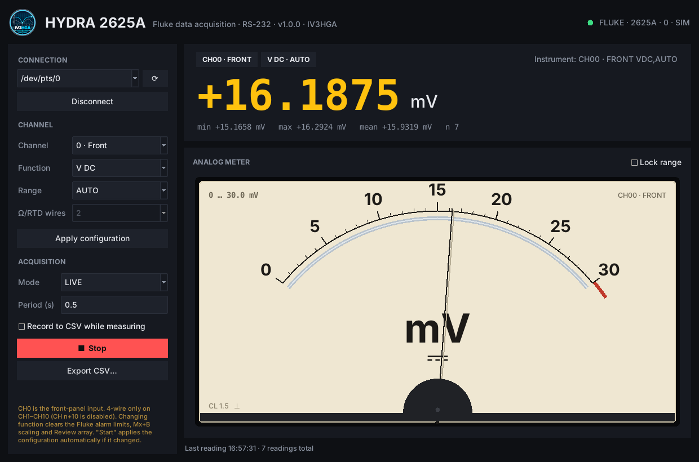
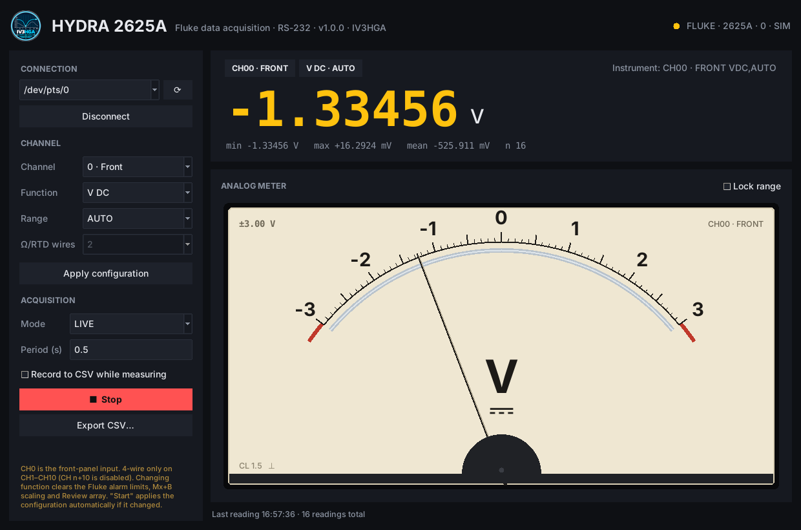
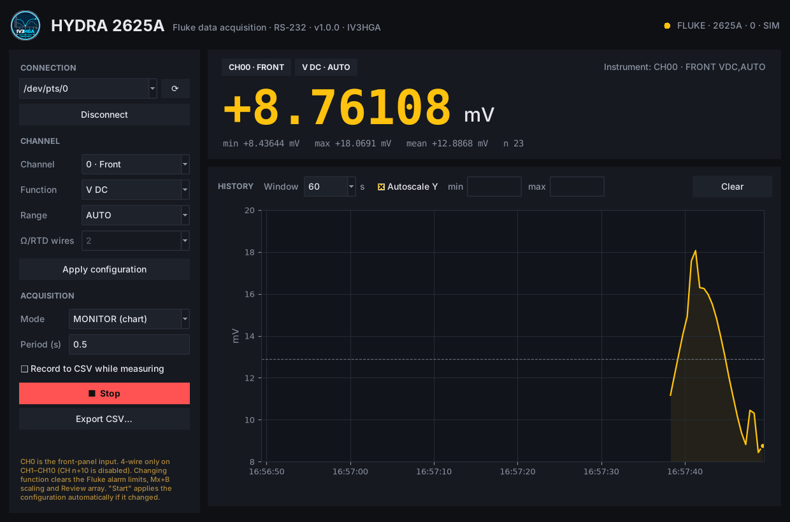

# User guide

The window has three areas: the **sidebar** on the left (all controls), the **readout card** at the
top right and the **view** below it (analog meter or chart, depending on the mode). A status line
runs along the bottom.

## Header

- IV3HGA logo, application name, version.
- **Status LED**: grey = disconnected, green = connected, yellow flash = a reading just arrived,
  red = the last operation ended with an error.
- The instrument identification returned by `*IDN?`.

## Sidebar

### Connection

| Control | Description |
|---|---|
| Port | Serial device (`/dev/ttyUSB0`, `/dev/ttyS0`, …). Editable, so you can type a path that is not listed. |
| ⟳ | Re-scan the available serial ports. |
| Connect / Disconnect | Opens the port, sends Ctrl-C to cancel any pending command, then `*IDN?`. |

### Channel

| Control | Description |
|---|---|
| Channel | `0 · Front` is the **front-panel input**; 1–20 are the rear scanner channels. |
| Function | V DC, V AC, Ohm, Frequency, Thermocouple, RTD Pt100, OFF. |
| Range | AUTO or a fixed range; for thermocouples the type (J K E T N R S B C). |
| Ω/RTD wires | 2 or 4. 4-wire is allowed only on CH1–CH10 and uses CH n+10 for the sense leads. |
| Apply configuration | Sends `SCAN 0`, `FUNC …` and reads back `FUNC?`. The instrument's answer is shown at the top right of the readout card. |

> Changing function on the Hydra clears that channel's alarm limits, Mx+B scaling and Review array.

### Acquisition

| Control | Description |
|---|---|
| Mode | LIVE, MONITOR (chart), Trigger + LAST? (see below). Changing mode stops a running measurement. |
| Period (s) | Time between readings, 0.5 … 3600 s. Readings are scheduled on a fixed grid, so the period does not drift. |
| Record to CSV while measuring | At Start you are asked for a file name (default `hydra_CH00_front_YYYYMMDD_HHMMSS.csv`); every reading is written and flushed immediately. A red **● REC** chip is shown while recording. |
| ▶ Start / ■ Stop | Starts or stops the acquisition. Start applies the channel configuration first if it differs from what is loaded in the instrument. |
| Export CSV… | Saves all readings of the session (all runs since the program was started). |

## Readout card

- Chips with the channel (`CH00 · FRONT`) and function/range of the running measurement.
- The value, with an SI prefix (`+16.0495 mV`, `+4.70213 kΩ`). Overload shows **OL** in red.
- Statistics of the current run: min, max, mean, number of valid readings and number of overloads.

## Modes

### LIVE — analog meter

Uses the Hydra *Monitor* function (`MON 1,ch` then `MON_VAL?` at every period).

The meter imitates a panel moving-coil instrument:

- **Ranges** follow the classic 1-3-10-30 sequence. The meter ranges **up** immediately when the
  value exceeds full scale and ranges **down** only after 4 consecutive readings that fit at least
  10 % inside the lower range, so it does not hunt at range boundaries.
- **Lock range** freezes the current range (useful when adjusting something to a fixed point).
- **Centre-zero**: for V DC and temperature, as soon as a negative value is seen (within the last
  20 readings) the scale becomes ±FS.
- The needle is a 2nd-order system (ωn ≈ 13 rad/s, ζ = 0.55): it moves with a slight overshoot
  like a real movement and bounces on the end stops.
- **Overload**: the needle goes to the right end stop and the red **OL** lamp lights.

### MONITOR — chart

Same acquisition as LIVE, with a scrolling history chart instead of the meter.

| Control | Description |
|---|---|
| Window | Visible time span: 10 s … 3600 s. The axis keeps scrolling even when readings are slow. |
| Autoscale Y | Smart autoscale: the axis **expands at once** when the signal leaves it and **shrinks only** when the signal uses less than about one third of it. Limits are rounded to nice values. |
| min / max | Manual limits, used when Autoscale is off. Accept SI suffixes: `300m`, `-1.5`, `2k`, `10M`. When you untick Autoscale they are pre-filled with the current limits. |
| Clear | Clears the chart history (not the CSV log). |

The Y axis uses an SI prefix chosen from the data (mV, kΩ, …). A dashed line shows the mean of the
visible points; overload readings break the line.

### Trigger + LAST?

At every period the software sends `*TRG` and then `LAST? ch`. Intended for setups where the
Hydra scans on its own configuration. The display is the same as LIVE.

## Error handling

- A single failed or timed-out reading is retried (up to 3 consecutive failures) and reported in the status line; the measurement continues.
- After 3 consecutive failures, or on a configuration error, the measurement stops and the LED turns red.
- On Stop, Disconnect and window close, `MON 0` is sent so the instrument is left in a clean state.

## Keyboard / tips

- In the min/max fields, press **Enter** to apply.
- The window is resizable: the meter and the chart scale with it.
