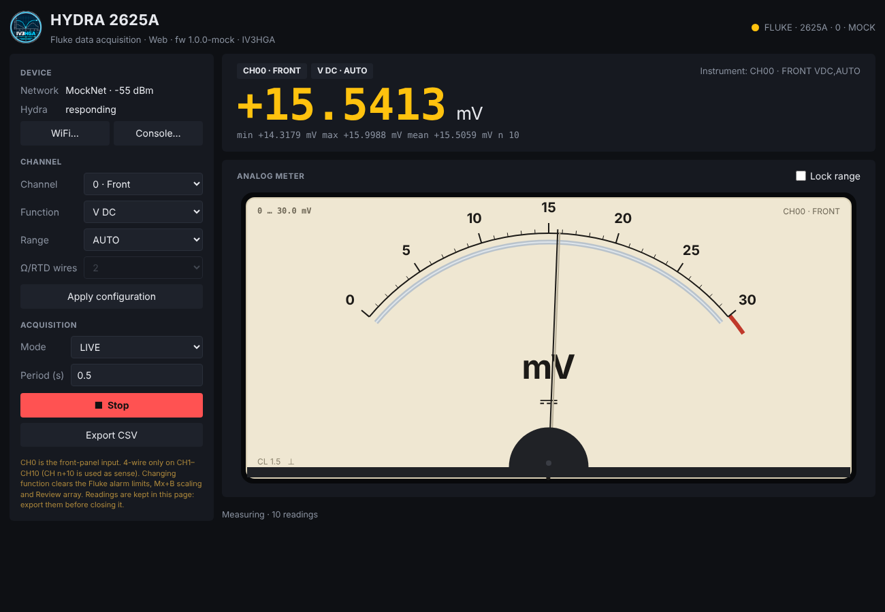
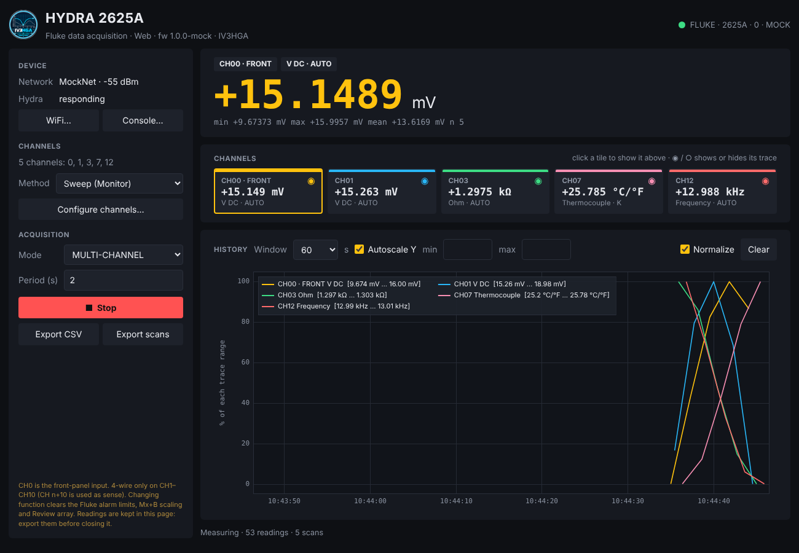
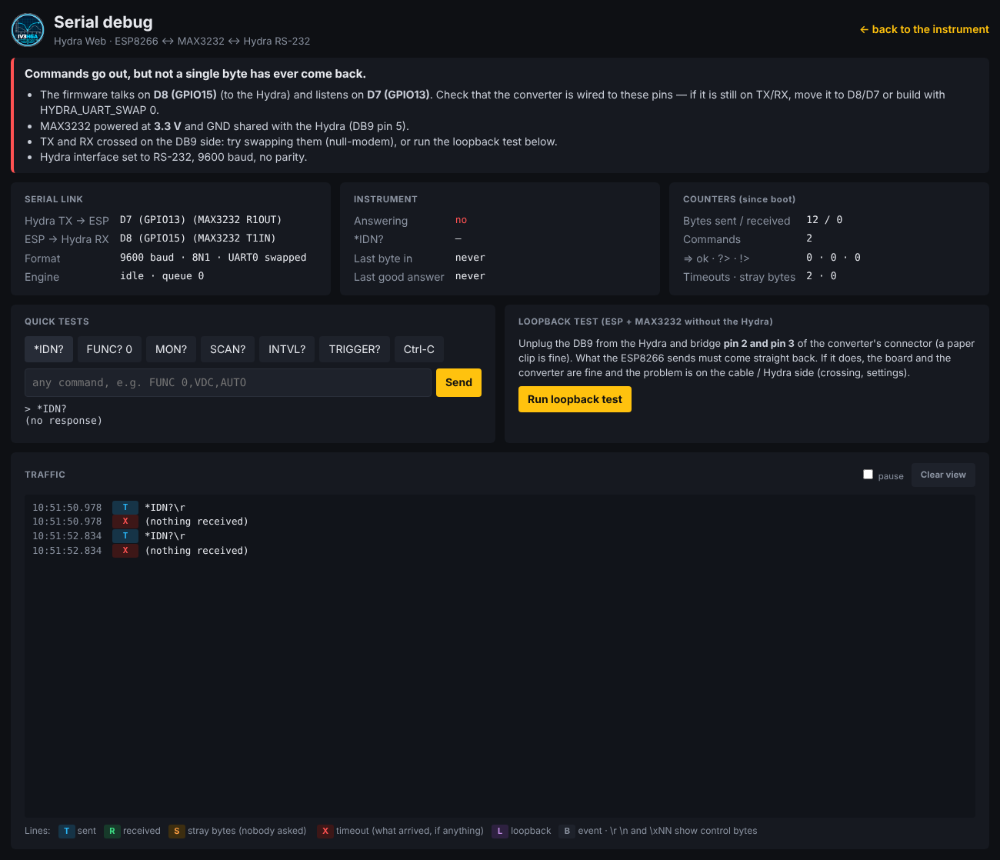

# Hydra Web — ESP8266 firmware

A Wemos D1 mini (Pro) with a MAX3232 turns the Fluke Hydra 2620A/2625A into a network
instrument: open **http://hydra.local** from any browser, phone included, and you get the same
interface as the desktop app.

<p align="center">
  
  
</p>

## What it does

- **Same modes as the desktop app**: LIVE (analog meter), MONITOR (chart), Trigger + LAST?,
  MULTI-CHANNEL (Sweep through the Monitor, or experimental Hydra scan).
- **Same interface**: big readout with statistics, damped moving-coil meter with 1-3-10 auto-ranging and
  centre-zero, chart with smart autoscale / manual limits / Normalize, channel tiles, channel setup window.
- **The device measures, the page displays**: acquisition runs on the ESP8266, so it continues with the
  browser closed. Opening the page again (from any device) picks up the running session and the last
  600 readings kept on the device.
- **CSV export** from the page: all readings (long format) and, in multi-channel, one row per scan.
- **Command console** to send raw commands to the Hydra — handy to check the Hydra-scan syntax.
- **Serial debug page** with diagnosis, counters, live traffic and a loopback test.
- **PC bridge**: the desktop app can connect over WiFi to `socket://hydra.local:2625`; while it is
  connected, web control is paused.
- WiFi setup from the page, access point fallback with captive portal, mDNS name, OTA updates.
- No external libraries: only the ESP8266 Arduino core. The page needs no internet (no CDN).

## Hardware

```
 Wemos D1 mini Pro            MAX3232 module (3.3 V)          Hydra RS-232 (DB9)
 ─────────────────            ──────────────────────          ──────────────────
 3V3  ─────────────────────── VCC
 GND  ─────────────────────── GND ─────────────────────────── pin 5  GND
 D8  (GPIO15) ─────────────── T1IN      T1OUT ─────────────── RX of the Hydra
 D7  (GPIO13) ─────────────── R1OUT     R1IN  ─────────────── TX of the Hydra
 5V  ── supply (USB or a 5 V step-down from the Hydra's 9–16 V DC supply)
```

- **Use D8/D7, not TX/RX.** TX/RX (GPIO1/GPIO3) are shared with the board's USB-serial chip: with the
  converter on them, uploads fail (two outputs fight on RX) and the ESP8266 boot messages reach the
  Hydra. The firmware moves UART0 to D8/D7 in hardware (`Serial.swap()`, `HYDRA_UART_SWAP 1`, the
  default), so USB stays free and the link is just as fast and reliable as on TX/RX.
- Prefer to keep TX/RX? Build with `HYDRA_UART_SWAP 0` and unplug the converter while flashing.
- D8 must be low at boot: the D1 mini has a pull-down on it, which is fine with a MAX3232 input. If the
  board does not start with the converter connected, check that the module has no strong pull-up on T1IN.
- Power the MAX3232 from **3.3 V**, never 5 V: its outputs drive the ESP8266 pins directly.
- If the Hydra never answers, open the **debug page** (below): it tells you whether anything comes back
  and has a loopback test for the board and the converter.

## Serial debug page

Open **http://hydra.local/debug** (or *Debug…* in the main page).

<p align="center"></p>

- **Diagnosis** in plain words: nothing ever received, bytes but no valid answer (baud/parity),
  communication OK, commands refused with `?>`, lost answers.
- **Serial link**: the pins in use, format, engine state; **counters** since boot (bytes, commands,
  `=>`/`?>`/`!>`, timeouts, stray bytes) and the last byte / last good answer.
- **Quick tests**: `*IDN?`, `FUNC? 0`, `MON?`, `SCAN?`, `INTVL?`, `TRIGGER?`, Ctrl-C and any command.
- **Loopback test**: unplug the Hydra, bridge pins 2 and 3 of the converter's DB9 and run it: if the
  probe comes back, ESP8266 and MAX3232 are fine and the problem is on the cable/Hydra side.
- **Traffic**: the last 48 lines on the wire, live: sent, received, stray bytes, timeouts, with
  `\r`, `\n` and `\xNN` for control bytes.

## Build and flash

### Arduino IDE

1. *File → Preferences → Additional boards manager URLs*:
   `https://arduino.esp8266.com/stable/package_esp8266com_index.json`, then install **esp8266** (3.1.x)
   from the Boards Manager.
2. Open `firmware/hydra_web/hydra_web.ino`.
3. *Tools → Board*: **LOLIN(WEMOS) D1 mini Pro** (or *D1 mini*). Keep a *Flash Size* with a file system
   (the default, e.g. *16MB (FS:14MB OTA:~1019KB)*).
4. Edit `config.h` if you like (WiFi, pins), then **Upload**.

### PlatformIO

```bash
cd firmware
pio run -e d1_mini_pro -t upload        # or -e d1_mini
```

### Updating over WiFi

After the first USB flash, the board shows up as network port **hydra** in the Arduino IDE
(*Tools → Port*), or: `pio run -e d1_mini_pro -t upload --upload-port hydra.local`.

## First start

1. With no network configured, the board opens an access point **Hydra-XXXX**
   (password `hydra2625`, change it in `config.h`). Connect: the page opens by itself (captive portal),
   otherwise browse to **http://192.168.4.1**.
2. **WiFi…** → network name and password → *Save & restart*.
3. Back on your network, open **http://hydra.local** (or the IP from your router).

If the saved network is not reachable at boot, the access point comes back and the board keeps trying
to join the network in the background.

## Using the PC bridge

In the desktop app choose the port `socket://hydra.local:2625` (it is in the port list) and press
Connect. The web page shows a banner while the PC is connected; closing the desktop app frees the
line again.

## Editing the page

The page is `hydra_web/web/index.html` (plain HTML/CSS/JS). After editing it:

```bash
python3 firmware/build_web.py          # regenerates hydra_web/web_page.h (gzip)
```

To try changes without flashing, run the mock device and open http://localhost:8080:

```bash
python3 firmware/mock_server.py        # same API, simulated readings
```

## HTTP API

| Method | Path | Parameters / answer |
|---|---|---|
| GET | `/api/status` | device, instrument, session and WiFi state (JSON) |
| GET | `/api/readings?since=SEQ` | `{"now","seq","more","r":[[seq, t_ms, ch, value or null, scan],…]}`, at most 200 per call |
| POST | `/api/start` | `mode` (live, monitor, trigger, multi), `method` (sweep, hscan), `period` (ms), `f` (`ch\|FUNC …;…`), `desc` (JSON echoed back in status) |
| POST | `/api/stop` | — |
| POST | `/api/cmd` | `c`: one raw command (only while stopped) → `{"out": answer + prompt}` |
| GET/POST | `/api/config` | the channel setup (JSON, stored on the device) |
| POST | `/api/wifi` | `ssid`, `pass` → saves and restarts |
| POST | `/api/reboot` | — |
| GET | `/api/debug?since=SEQ` | pins, counters and the traffic lines after SEQ |
| POST | `/api/loopback` | sends a probe and reports what came back (`pass`, `bytes`, `recv`) |
| POST | `/api/ctrlc` | sends Ctrl-C (0x03) to the Hydra |

`t_ms` is the device's `millis()`; the page converts it with the `now` of the same answer.

## Notes

- Readings kept on the device: the last 600. The page keeps everything it receives (up to 200 000
  readings) until it is closed: export before closing it.
- The *Hydra scan* commands are in `config.h` (`HSCAN_*`); they have not yet been verified on a real
  unit. Use the console to check `INTVL?`, `TRIGGER?`, `SCAN?` and adjust them if the Hydra answers `?>`.
- Overrange is detected as |value| ≥ 9E+9 or an `OL` answer, like in the desktop app.
