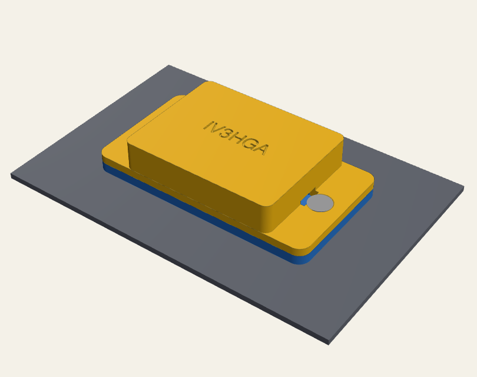
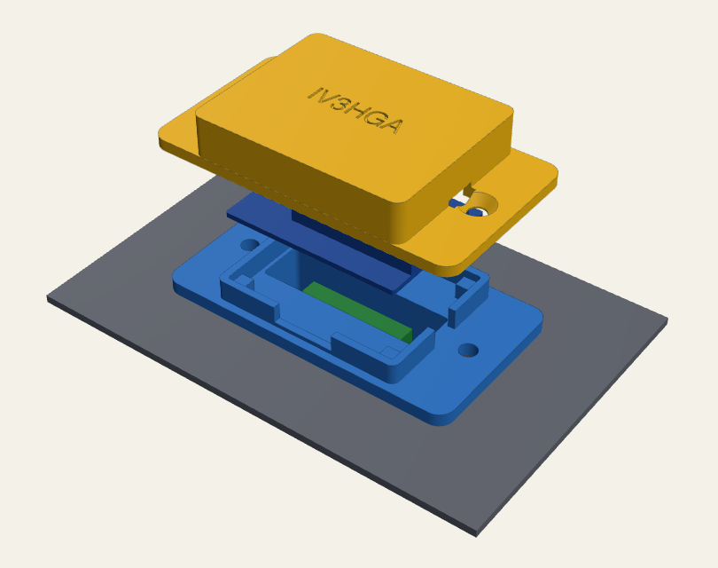
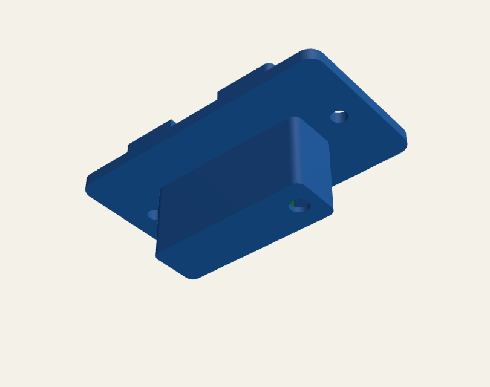
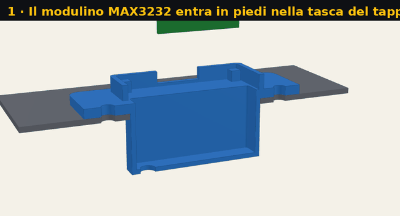

# Hardware

Mechanical parts for the Fluke Hydra 2620A/2625A and the [Hydra Web](../firmware/README.md) WiFi board.

## [GPIB plate](gpib_plate/README.md) — Wemos D1 mini on the unused IEEE-488 opening

  
  
  

A 2.5 mm plate screwed through the two GPIB holes. Its tongue, shaped like the slot, fits inside the
opening and holds the mini MAX3232 module; the Wemos sits outside under a low cover.
**12 mm** outside the panel, nothing drilled, fully reversible.

| | |
|---|---|
| Model | [`hydra_wemos_plate.FCMacro`](gpib_plate/hydra_wemos_plate.FCMacro) — parametric, runs in FreeCAD or with CadQuery |
| CAD | [`hydra_wemos_plate.step`](gpib_plate/hydra_wemos_plate.step) |
| Print | [`hydra_wemos_plate.stl`](gpib_plate/hydra_wemos_plate.stl), [`hydra_wemos_plate_cover.stl`](gpib_plate/hydra_wemos_plate_cover.stl) (print-oriented) |
| Hardware | 2 × M3 × 10 countersunk + nuts, Wemos D1 mini (Pro), mini MAX3232 module |
| Instructions | [measurements to check, printing, assembly](gpib_plate/README.md) |
