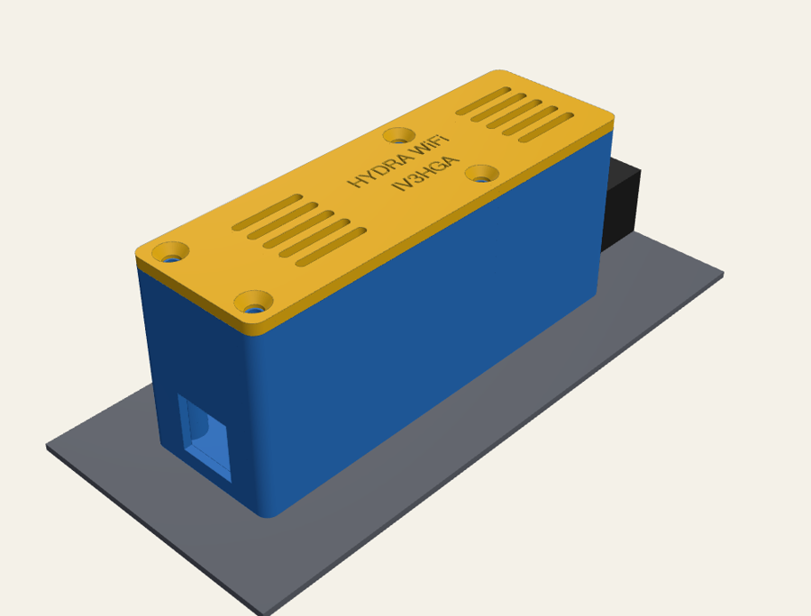
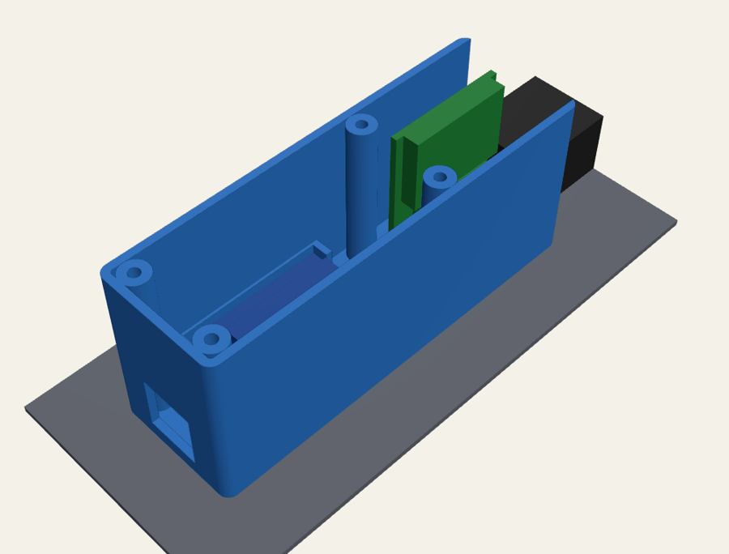
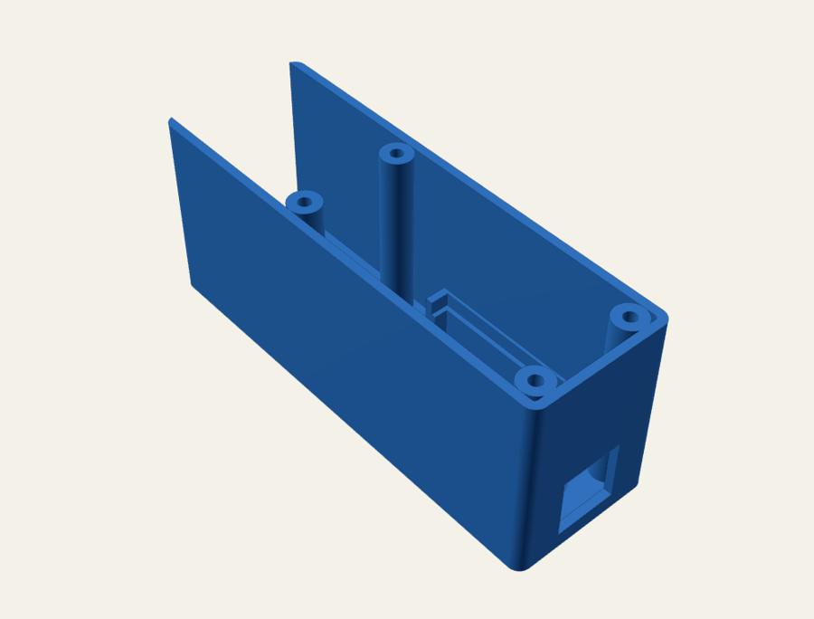

# Hydra Web case — Wemos D1 mini Pro on the GPIB opening

A printed box for the [Hydra Web](../../firmware/README.md) board that uses what the Hydra
2620A/2625A already has on its back panel:

- it is screwed through the two holes of the **unused IEEE-488 (GPIB) opening**;
- the **MAX3232 module's DB9 female plugs straight into the RS-232 port** just above it: no cable;
- the Wemos D1 mini Pro sits in a cradle over the GPIB opening, USB facing down for power.

  
  

  
  

Outer size ≈ 31 × 96 × 42 mm. Nothing is drilled and nothing changes on the instrument.

## Files

| File | What |
|---|---|
| `hydra_wemos_case.FCMacro` | the parametric model: FreeCAD macro **and** CadQuery script |
| `hydra_wemos_case.step` | body + lid, to open in FreeCAD (or any CAD) |
| `hydra_wemos_case_body.stl` | body, already in print orientation (back plate on the bed) |
| `hydra_wemos_case_lid.stl` | lid, in print orientation (outer face on the bed) |

## Before printing: measure (caliper)

The model was drawn from photos plus the standard connector dimensions. Check these and change them
at the top of the macro (marked `(*)`):

| Parameter | Default | What to measure |
|---|---|---|
| `db9_to_gpib` | 12.0 | centre of the **lower DB9 hex standoff** → centre of the **upper GPIB hole** |
| `gpib_pitch` | 47.04 | distance between the two GPIB holes (IEEE-488 standard value) |
| `gpib_dx` | 0.0 | sideways offset between the DB9 axis and the GPIB holes |
| `x_left`, `x_right` | −16 / +15 | free space each side of the DB9 axis (print on the left, option slot on the right) |
| `y_top` | 15.5 | top end of the box: the terminal block starts right above the DB9 flange |
| `depth` | 42 | the MAX3232 board sticks out ~35 mm from the panel once plugged in |

Also check the MAX3232 module: the model assumes a module with a **right-angle DB9 female** whose
board stands perpendicular to the panel (the common blue/red modules). The inside is an open
volume of about 27 × 33 mm around the DB9, so most modules fit.

## Change it in FreeCAD

1. *Macro → Macros…*, select `hydra_wemos_case.FCMacro`, **Execute**: you get *Body* and *Lid*.
2. Edit the numbers in the `P = dict(...)` block (*Macro → Macros… → Edit*), run it again.
3. *File → Export* each part as STL (or STEP).

Or from a terminal: `pip install cadquery` then `python3 hydra_wemos_case.FCMacro` rewrites the STEP and
STL files next to it.

## Print

- **PETG or ASA** (not PLA: it softens near a warm instrument).
- 0.2 mm layers, 3 perimeters, 20–30 % infill, **no supports** with the STL orientations provided.
- The lid prints with its engraved face on the bed: the text comes out crisp.

## Parts

| Qty | Part |
|---|---|
| 2 | M3 × 8 countersunk screws for the GPIB holes (+ 2 M3 nuts behind the panel, see below) |
| 4 | M3 × 8 screws for the lid (they thread directly into the 2.5 mm holes of the bosses) |
| 1 | Wemos D1 mini Pro, a MAX3232 module with DB9 female, a few wires |
| — | a dot of hot glue or double-sided foam tape to keep the Wemos in its cradle |

## Assembly

1. Wire the Wemos to the MAX3232 (3V3, GND, **D8 → T1IN/TXD**, **D7 ← R1OUT/RXD**) with ~6 cm wires.
2. Screw the body to the panel with the two countersunk M3 screws through the GPIB holes, heads
   inside the box. With **nuts behind the panel** (open the instrument once) the box is clamped;
   without nuts the screws still act as locating pins and the DB9 holds the box.
3. Plug the MAX3232 into the RS-232 port through the window in the back plate and, if your module
   has them, tighten its DB9 screws into the Hydra's hex standoffs.
4. Lay the Wemos in its cradle, antenna end up, USB towards the opening in the bottom wall.
5. Close the lid with the four M3 screws. Power from USB.

If the Hydra does not answer, open **http://hydra.local/debug**: with the DB9 plugged directly, a
module wired as "PC side" needs TX/RX crossed — just swap the D7/D8 wires.
