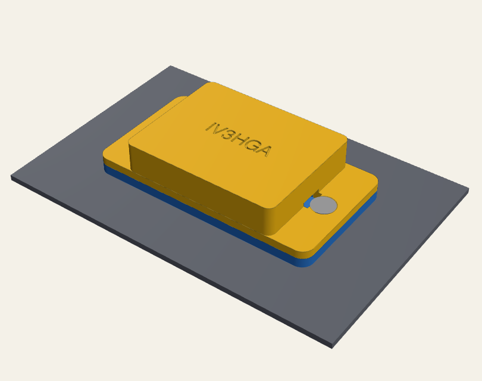
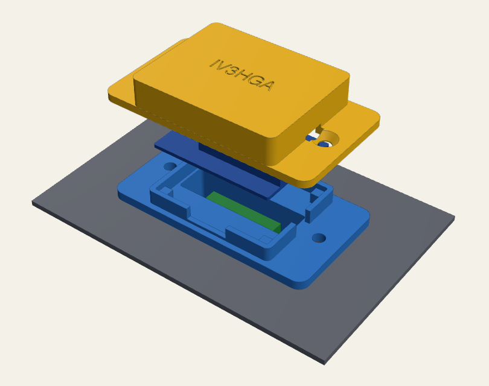
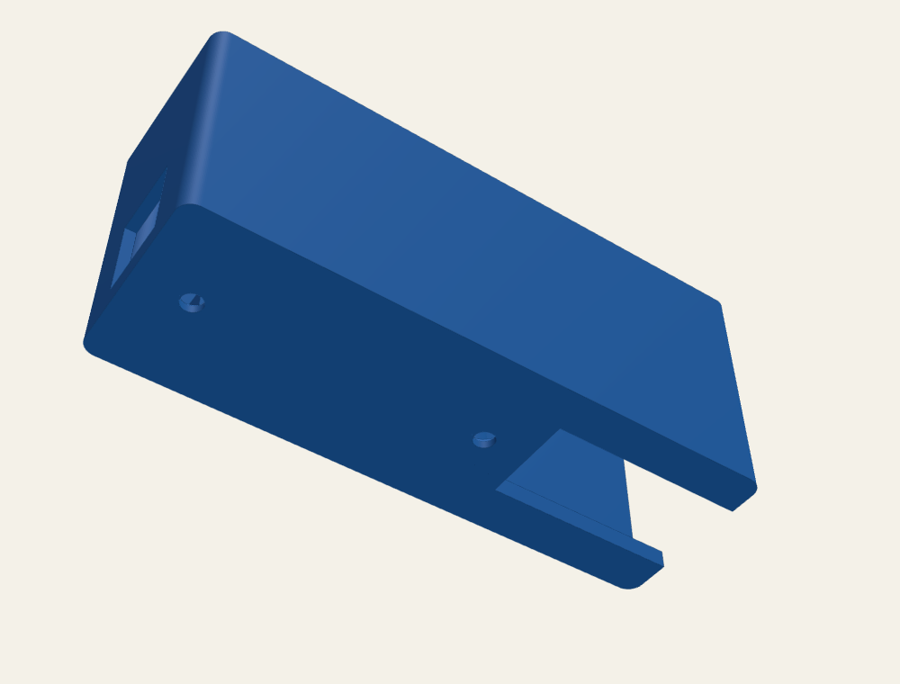

# Hydra Web plate — Wemos D1 mini on the GPIB opening

A thin printed mount for the [Hydra Web](../../firmware/README.md) board that uses the
**unused IEEE-488 (GPIB) opening** on the back of the Hydra 2620A/2625A:

- a 2.5 mm plate screwed through the two GPIB holes;
- on its back, a **tongue shaped like the GPIB slot** that fits inside it: it aligns the plate and
  gives it structure, and it is hollow — the **mini MAX3232 module stands on edge inside it**,
  within the slot;
- the **Wemos lies on the outside**, parallel to the slot, under a low cover clamped by the same
  two screws. **12 mm** in total outside the panel.

  
  
  

Nothing is drilled and nothing changes on the instrument.

## Files

| File | What |
|---|---|
| `hydra_wemos_plate.FCMacro` | the parametric model: FreeCAD macro **and** CadQuery script |
| `hydra_wemos_plate.step` | plate + cover, to open in FreeCAD (or any CAD) |
| `hydra_wemos_plate.stl` | plate, in print orientation (standing on the tongue) |
| `hydra_wemos_plate_cover.stl` | cover, in print orientation (top face on the bed) |

## Before printing: measure (caliper)

Change the values at the top of the macro (marked `(*)`):

| Parameter | Default | What to measure |
|---|---|---|
| `slot_len`, `slot_w` | 36.0 × 12.0 | the GPIB slot at its narrowest (it is D-shaped: take the short side) |
| `gpib_pitch` | 47.04 | distance between the two GPIB holes (IEEE-488 standard value) |
| `panel_t` | 1.5 | panel thickness |
| `plate_w` | 32 | free space across the slot (the option bay is on one side) |
| `tongue_depth` | 16 | free depth behind the panel at the slot (the main board is below) |
| `module_l`, `module_w` | 21.5 × 13.5 | your mini MAX3232 board |
| `fit_clear` | 0.20 | tongue clearance per side: 0.15 for a tighter fit, 0.3 if it does not go in |

The pocket is 33.2 × 9.2 × 17 mm with the defaults: the module stands on its long edge, chip
facing sideways.

## Change it in FreeCAD

1. *Macro → Macros…*, select `hydra_wemos_plate.FCMacro`, **Execute**: you get *Plate* and *Cover*.
2. Edit the numbers in the `P = dict(...)` block (*Macro → Macros… → Edit*) and run it again.
3. *File → Export* each part as STL (or STEP).

From a terminal: `pip install cadquery`, then `python3 hydra_wemos_plate.FCMacro` rewrites the STEP and
STL files.

## Print

- **PETG or ASA** (not PLA: it softens near a warm instrument).
- 0.2 mm layers, 3 perimeters, 30 % infill.
- **Plate**: stands on the end of the tongue; enable **supports from the build plate only** for the
  plate ring around the tongue (tree supports work well).
- **Cover**: top face on the bed, no supports; the engraved callsign comes out crisp.

## Parts

| Qty | Part |
|---|---|
| 2 | M3 × 10 countersunk screws + 2 M3 nuts (behind the panel) |
| 1 | Wemos D1 mini / D1 mini Pro, mini MAX3232 module, thin wires |

## Assembly

1. Solder the wires: Wemos **3V3, GND, D8 → TX-in, D7 ← RX-out** of the MAX3232; on the RS-232 side
   **TX, RX, GND** to a DB9 female for the Hydra's RS-232 port (or, from inside the instrument,
   through the hole at the end of the tongue).
2. Slide the MAX3232 into the pocket from the front, wires up.
3. Push the tongue into the GPIB slot.
4. Lay the Wemos on its four pads inside the frame (ESP-12 up, antenna towards the DB9), wires
   through the gaps in the frame.
5. Put the cover on and fit the two screws through cover, plate and panel, with the nuts behind
   the panel. The cover presses the Wemos corners down.
6. Power: the 5V/GND wires leave through the notch at the DB9 end. To use the micro-USB socket
   instead, set `usb_opening=True` and raise `wemos_lift` to about 5 mm so the plug clears the plate.

If the Hydra does not answer, open **http://hydra.local/debug**; if TX and RX are crossed, swap the
D7/D8 wires.
